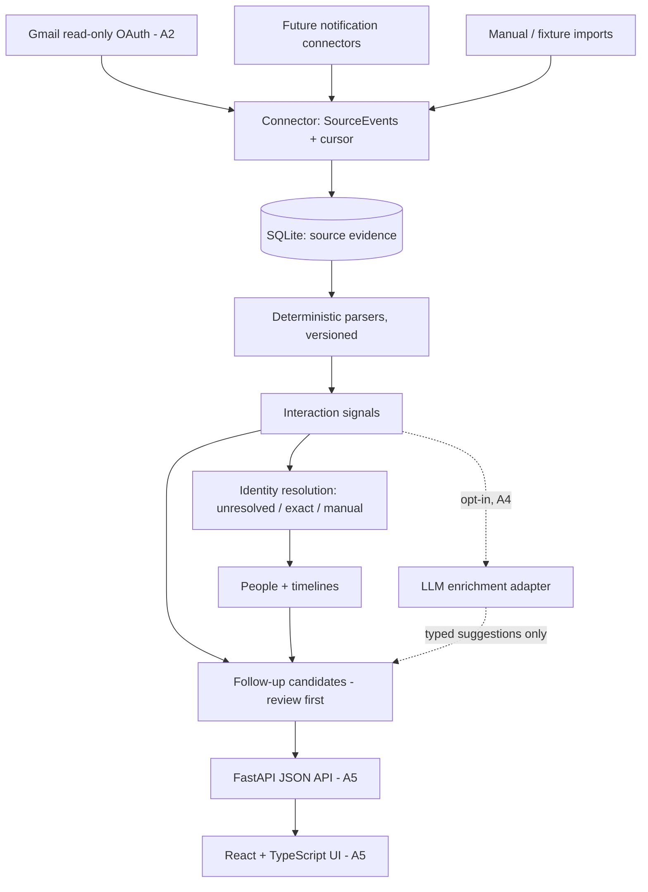

# Architecture — Phase A (person-centric)

## Domain model

**Person / Entity → Platform Identities → Interaction Signals → Follow-ups**

- **SourceEvent** (table `inbound_events`, evidence): `(source, account_id, external_id)` unique; provenance, sender, subject, capped excerpt (default 200 chars, `NOTIF_MGMT_EXCERPT_CHARS`), timestamps. Immutable; never carries inferred state.
- **SyncGap** (`sync_gaps`): explicit record of a potential gap created by bounded expired-cursor recovery (old/new cursor, recovery query, timestamp).
- **Person** (`people`): one human/org/unknown entity; display name, lightweight relationship notes.
- **Identity** (`identities`): an exact observed identifier (email, handle) on a platform. `person_id` is nullable — an identity exists *before* resolution. `match_status`: `unmatched | suggested | verified | rejected`; `match_method` and `confidence` record how it was linked.
- **InteractionSignal** (`interaction_signals`): a deduplicated interpretation of one source event — platform, kind (`direct_message_notification`, `platform_activity`, `direct_email`, `automated_notification`, `unclassified_email`), `occurred_at`, short summary, parser name/version, confidence, and an optional `actor_candidate`. An actor candidate is a display name only; it is **not** an identity and never creates a person by itself.
- **FollowUp** (`followups`): kind (`review | reply | waiting | follow_up`) × status (`open | snoozed | done | dismissed`), optional person/signal links, due/snooze fields, `created_by` (`rule | llm | user`).
- **SyncState** (`sync_state`): per `(source, account_id)` cursor, last success, last error metadata, recovery marker. The legacy `sync_cursors` table is still written for compatibility.

Schema is versioned with `PRAGMA user_version` (current: **3**); migrations preserve existing data (v1 `followups` rows are renamed to `followups_v1`, cursors are copied into `sync_state`, v3 rebuilds `inbound_events` account-scoped with foreign-key integrity verified).

## Identity resolution (minimal, A1)

1. **Unresolved** — exact identifiers (email/handle) are stored unmatched; display-name actors stay as `actor_candidate` on the signal.
2. **Exact match** — if an incoming exact identifier already belongs to a person, the signal associates automatically.
3. **Manual linking** — `link_identity` (identity → person, backfills signals/follow-ups) and `assign_signal_person` (name-only signal → person).

Deferred until needed: suggested matches, reversible merge workflows, cross-platform inference. Never match solely on display name.

## Invariants

- A notification is evidence of a possible interaction, not a transcript, and receipt does not imply an unanswered message. Notification-derived follow-ups are `review` candidates; `reply` requires stronger evidence or user confirmation.
- Source evidence is preserved separately from inferred state; parsers are versioned so signals can be re-derived.
- All external API errors are explicit. Never fake a successful sync.
- All data is exportable and deletable, with a self-hostable persistence layer.
- No agent writes to Gmail or social platforms. Read-only ingestion only.

## Gmail design (A2, implemented; live acceptance passed on a dedicated test mailbox)

1. OAuth installed desktop app, `gmail.readonly` scope, token stored in OS protected secret store or local file with strict permissions; don't commit credentials.
2. Initial sync via `users.messages.list` with explicit user query and bounded date range, fetch details selectively. Persist Gmail `historyId` from `users.getProfile` at a deliberate safe point; handle messages arriving during initial backfill with overlap + idempotent replay.
3. Every five minutes, use `users.history.list` from committed `historyId`, following all pages and handling adds/deletes/label changes as relevant.
4. Commit event inserts and cursor advancement atomically (in small recoverable batches).
5. On expired `startHistoryId` (404), perform a bounded recovery sync, record the recovery in `sync_state`, and surface any possible gap in Sources — never a silent reset.
6. Handle retries on 429/5xx, refreshing OAuth on 401 when appropriate; stop and request reauth for persistent access issues.
7. Use provider message IDs as dedupe keys; keep extraction rule versions separate from source evidence.

See `docs/gmail-oauth.md` for operator setup.

## Parser registry (A3)

Deterministic parsers live in `parsing.py` behind a versioned registry
(`PARSER_REGISTRY`, e.g. `linkedin-notifications` v1, `generic-email` v1);
the parser name/version is stamped on every signal for reproducibility.

- **Verified origin only.** A platform is asserted only when the sender
  address sits on a trusted platform domain (subdomains allowed). Wording
  that merely mentions a platform is never proof of origin: a sender that
  claims a platform without a verified domain, automated senders
  (no-reply/newsletter/notification local parts), and anything else
  unrecognized degrade to `platform="unknown"` with kind
  `unclassified_email` or `automated_notification`.
- **Conservative extraction.** Actor candidates and handle identities are
  extracted only from verified platform mail, via parenthesized `@handle`,
  Reddit `u/name`, named DM/invitation/mention subjects, and the Xiaohongshu
  DM template. Anonymous templates ("Someone sent you a message") yield no
  actor. Nothing is fabricated from unverified mail.
- **Follow-up gating.** Only `direct_message_notification`,
  `platform_activity`, and `direct_email` create review candidates;
  automated/unclassified signals are stored as evidence without follow-ups.
- **Upgrade safety.** The signal dedupe key is scoped to the source event
  (not the parser), so a parser upgrade replayed over old events cannot
  create duplicate signals or follow-ups; historical signals keep their
  original parser stamp.
- **Measured quality.** `fixtures/parser-corpus.json` holds synthetic
  positive/negative cases (ambiguous subjects, automated mail, misleading
  platform references); `tests/test_parser_corpus.py` computes per-platform
  precision/recall and hard-asserts zero fabricated identities and perfect
  actor/DM precision on the corpus.

## Future notifications

iPhone Mirroring exposes some app notifications to macOS; it is not guaranteed to deliver complete inbox state. A Mac notification observer must be explicitly permissioned and tested on the target macOS version, and its reliability must be documented before enabling background use.
