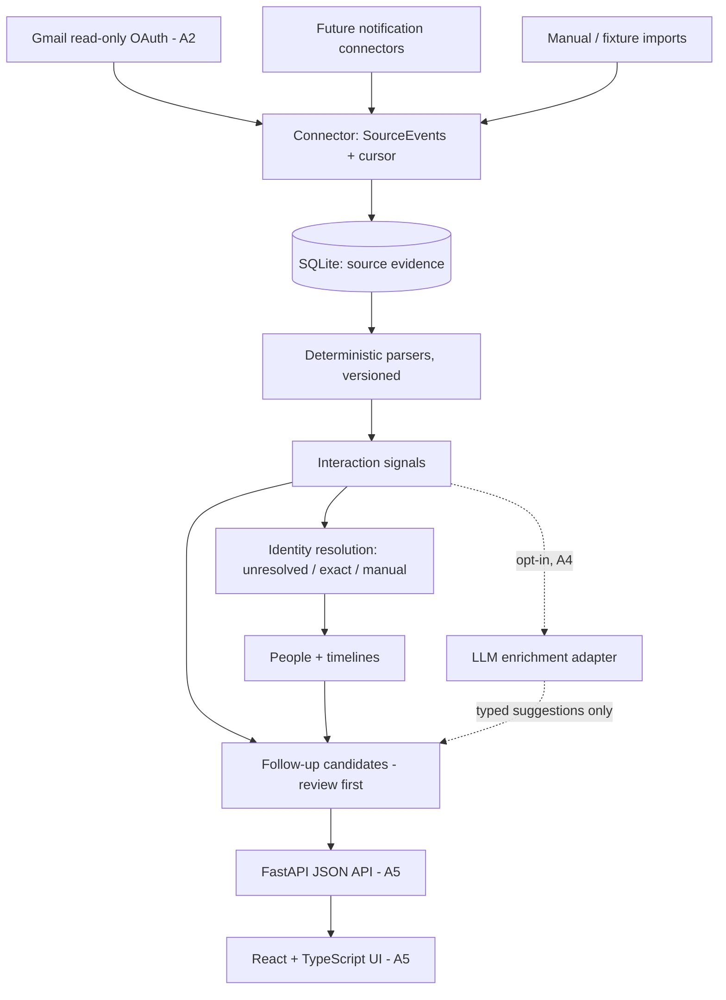

# Architecture — Phase A (person-centric)

## Domain model

**Person / Entity → Platform Identities → Interaction Signals → Follow-ups**

- **SourceEvent** (table `inbound_events`, evidence): `(source, account_id, external_id)` unique; provenance, sender, subject, capped excerpt (default 200 chars, `NOTIF_MGMT_EXCERPT_CHARS`), timestamps. Immutable; never carries inferred state.
- **SyncGap** (`sync_gaps`): explicit record of a potential gap created by bounded expired-cursor recovery (old/new cursor, recovery query, timestamp).
- **Person** (`people`): one human/org/unknown entity; display name, lightweight relationship notes.
- **Identity** (`identities`): an exact observed identifier (email, handle) on a platform. `person_id` is nullable — an identity exists *before* resolution. `match_status`: `unmatched | suggested | verified | rejected`; `match_method` and `confidence` record how it was linked.
- **InteractionSignal** (`interaction_signals`): a deduplicated interpretation of one source event — platform, kind (`direct_message_notification`, `platform_activity`, `direct_email`, `automated_notification`, `unclassified_email`), `occurred_at`, short summary, parser name/version, confidence, and an optional `actor_candidate`. An actor candidate is a display name only; it is **not** an identity and never creates a person by itself.
- **FollowUp** (`followups`): kind (`review | reply | waiting | follow_up`) × status (`open | snoozed | done | dismissed`), optional person/signal links, due/snooze fields, `created_by` (`rule | llm | user`).
- **SyncState** (`sync_state`): per `(source, account_id)` cursor, last success, last error metadata, recovery marker. The legacy `sync_cursors` table is still written for compatibility.

Schema is versioned with `PRAGMA user_version` (current: **3**); migrations preserve existing data (v1 `followups` rows are renamed to `followups_v1`, cursors are copied into `sync_state`, v3 rebuilds `inbound_events` account-scoped with foreign-key integrity verified).

## Identity resolution (minimal, A1; precedence hardened in A6-1)

Attribution precedence, highest first:

1. **Explicit user decisions** — a manual signal assignment or manual identity
   link. These are user-confirmed and are never silently overwritten.
2. **Exact identity match** — an incoming exact email/handle that already
   belongs to a person attributes the new signal to that person.
3. **Parser inference** — observed identities stay `unmatched` (method
   `parser`), and display names stay actor candidates. Inference alone never
   attributes anything to a person.

Rules that follow from the precedence:

1. **Unresolved** — exact identifiers (email/handle) are stored unmatched; display-name actors stay as `actor_candidate` on the signal.
2. **Exact match** — if an incoming exact identifier already belongs to a person, the signal associates automatically.
3. **Manual linking** — `link_identity` (identity → person) backfills only
   signals and follow-ups that have no person yet, so an earlier manual
   signal assignment survives a later identity link. Linking an identity
   already owned by a different person raises an error (the API maps it to
   409) instead of overwriting attribution. Attaching an already-observed
   unresolved identity through `add_identity` performs the same manual link.

Deferred until needed: suggested matches, reversible merge workflows, cross-platform inference. Never match solely on display name.

## Invariants

- A notification is evidence of a possible interaction, not a transcript, and receipt does not imply an unanswered message. Notification-derived follow-ups are `review` candidates; `reply` requires stronger evidence or user confirmation.
- Source evidence is preserved separately from inferred state; parsers are versioned so signals can be re-derived.
- All external API errors are explicit. Never fake a successful sync.
- All data is exportable and deletable, with a self-hostable persistence layer.
- No agent writes to Gmail or social platforms. Read-only ingestion only.

## Gmail design (A2, implemented; live acceptance passed on a dedicated test mailbox)

1. OAuth installed desktop app, `gmail.readonly` scope, token stored in OS protected secret store or local file with strict permissions; don't commit credentials.
2. Initial sync via `users.messages.list` with explicit user query and bounded date range, fetch details selectively. Persist Gmail `historyId` from `users.getProfile` at a deliberate safe point; handle messages arriving during initial backfill with overlap + idempotent replay.
3. Every five minutes, use `users.history.list` from committed `historyId`, following all pages and handling adds/deletes/label changes as relevant.
4. Commit event inserts and cursor advancement atomically (in small recoverable batches).
5. On expired `startHistoryId` (404), perform a bounded recovery sync, record the recovery in `sync_state`, and surface any possible gap in Sources — never a silent reset.
6. Handle retries on 429/5xx, refreshing OAuth on 401 when appropriate; stop and request reauth for persistent access issues.
7. Use provider message IDs as dedupe keys; keep extraction rule versions separate from source evidence.

See `docs/gmail-oauth.md` for operator setup.

## Deletion consistency (A6-2)

Permanent deletion at the source withdraws the derived signal but never
erases source evidence or the withdrawn signal itself, so historical
attribution stays inspectable. Withdrawal auto-dismisses only follow-ups
that are simultaneously open, of kind `review`, and system-generated
(`created_by='rule'`). User-confirmed obligations (`reply`, `waiting`,
`follow_up`), user-created reviews, snoozed reviews, and already-resolved
follow-ups are deliberate state and are left untouched. Only signals that
transition to withdrawn in the current call take part, which makes a
repeated deletion a no-op and protects a candidate the user deliberately
reopened. Gmail incremental sync applies event inserts, withdrawals, and
cursor advancement in one SQLite transaction, so an interrupted sync
either applies none of them or leaves a fully consistent state behind.
Replay cannot recreate a dismissed candidate because signal dedupe is
scoped to the source event. No schema change was needed because kind,
status, and `created_by` already encode the policy distinction.

## Crash consistency and self-healing (A6-4)

The strong atomic unit is the Gmail batch commit. Source-event inserts,
withdrawals for previously derived signals, review-candidate dismissals,
and cursor advancement either commit together or roll back together.
Signal derivation is intentionally a separate self-healing step rather
than part of that transaction. Each derived signal and its initial
follow-up commit together, and a later sync derives only events that
still have no signal. Incremental sync now repairs missing signals from
earlier committed batches before applying new deletions, so an event
deleted while underived is withdrawn instead of being resurrected.

The resulting guarantee is eventual consistency after a crash between
the batch commit and derivation. The database can temporarily contain
committed evidence and an advanced cursor without the corresponding
signals or follow-ups until the next successful sync. API reads in that
window are internally consistent for each request but can show the
not-yet-derived state. Identity rows can also exist briefly before their
signal if derivation stops between identity creation and signal insert;
the next derivation reuses them. Manual assignments, confirmed
obligations, withdrawn signals, and dismissed candidates are not reset
by repair or replay.

One narrower window remains open as deferred engineering work. A message
first added and permanently deleted inside the same previously unseen
history batch has no stored signal for the batch withdrawal to act on,
so its post-commit derivation can still create an active signal. This is
not a resolved guarantee. Closing it would require deletion tombstones
for previously unseen events or an equivalent derivation-suppression
mechanism. That window does not affect the atomicity of events,
derived-state withdrawals, dismissals, and cursor advancement for
previously stored events.

## Expired-cursor recovery atomicity (A6-5)

Bounded recovery from an expired Gmail history cursor commits its events,
cursor advancement, `sync_gaps` row, and `sync_state.last_recovery_at`
timestamp in the same SQLite transaction as the recovered batch. A crash
or failure while recording the gap therefore rolls back the recovered
events and cursor together, and a later retry can apply the complete
recovery. Signal derivation remains the separate self-healing step
described above, so recovery does not claim that signals or follow-ups
are part of that transaction. Replaying a recovery inserts no duplicate
events, signals, or follow-ups. A distinct later expiration is a distinct
recovery and records its own gap row.

## Web API (A5, in progress)

- **A5a (implemented):** `src/notif_mgmt/api.py` is a thin FastAPI layer over
  the storage repositories and Pydantic domain models — no ORM, no new
  tables. Read-only `/api/v1` endpoints: `today` (due / snoozed-ready /
  review-candidates, grouped separately so candidates are never presented as
  obligations), `people` (with identity/platform/activity aggregates),
  `people/{id}` (identities, newest-first signal timeline, follow-ups),
  `identities`, `followups`, `signals`, `sources` (sync metadata + gap
  counts, never secrets). Unknown person returns 404.
- **A5b (implemented):** mutation endpoints under the same prefix — create
  person, attach exact identity, link identity (409 when owned by another
  person), assign name-only signal, and PATCH follow-ups. Follow-up
  transitions are a storage-level state machine: open ⇄ snoozed (snooze
  requires `snoozed_until`), open/snoozed → done/dismissed (stamps
  `resolved_at`), resolved → open (clears `resolved_at`); `due_at` and
  `snoozed_until` are explicitly clearable. Mutations are guarded by a
  localhost Host check plus a localhost Origin check when Origin is sent —
  CORS alone is not treated as a security boundary.
- The React/TypeScript/Vite frontend lives in `web/` with a hand-typed API
  client and hash routing.
- **A5c (implemented):** app shell plus Today (due / expired snoozes /
  review candidates) and People (summaries + unresolved-identity queue)
  pages, with Vitest component tests against a mocked API client.
- **A5d (implemented):** Person Detail (notes editing via
  `PATCH /api/v1/people/{id}`, identity linking, name-only signal
  assignment, newest-first timeline with parser provenance, in-place
  follow-up controls), the Follow-ups triage page with status filter, and
  the Sources page (sync metadata plus explicit sender-domain, not
  SPF/DKIM/DMARC, language).
- **A5e (implemented):** FastAPI mounts the production React build
  (`web/dist`, created by `cd web && npm run build`) after the API routes
  for a single-process local app; without a build the API works unchanged.
  A Playwright golden-path test (review candidate → create person → link
  identity → complete follow-up) runs against a throwaway synthetic
  database seeded by the CLI demo. Run everything locally with
  `python -m pip install -e '.[web]'`, `cd web && npm install && npm run build`,
  then `NOTIF_MGMT_DB=<path> uvicorn notif_mgmt.api:app --host 127.0.0.1`.
- Deployment is single-user local: bind to localhost only, database path via
  `NOTIF_MGMT_DB`. The API returns capped summaries and metadata only.
- A signal's `platform` reflects A3 sender-domain matching against trusted
  platform domains. It is **not** SPF/DKIM/DMARC authentication of message
  origin, and UI copy must not claim otherwise.

## Parser registry (A3)

Deterministic parsers live in `parsing.py` behind a versioned registry
(`PARSER_REGISTRY`, e.g. `linkedin-notifications` v1, `generic-email` v2);
the parser name/version is stamped on every signal for reproducibility.

- **Verified origin only.** A platform is asserted only when the sender
  address sits on a trusted platform domain (subdomains allowed). Wording
  that merely mentions a platform is never proof of origin: a sender that
  claims a platform without a verified domain, automated senders
  (no-reply/newsletter/notification/promotion local parts), and anything else
  unrecognized degrade to `platform="unknown"` with kind
  `unclassified_email` or `automated_notification`.
- **Conservative extraction.** Actor candidates and handle identities are
  extracted only from verified platform mail, via parenthesized `@handle`,
  Reddit `u/name`, named DM/invitation/mention subjects, and the Xiaohongshu
  DM template. Anonymous templates ("Someone sent you a message") yield no
  actor. Nothing is fabricated from unverified mail.
- **Follow-up gating.** Only `direct_message_notification` and
  `direct_email` create review candidates, because only those kinds
  reasonably indicate direct interpersonal outreach from the notification
  alone. Routine `platform_activity` such as likes, invitations, mentions,
  replies, trending posts, promotions, and account notices remains stored
  interaction evidence without a candidate. Automated and unclassified
  signals follow the same evidence-only rule. The gate applies when a
  signal is first inserted, so tightening it never deletes an existing
  user-created or user-confirmed follow-up.
- **Upgrade safety.** The signal dedupe key is scoped to the source event
  (not the parser), so a parser upgrade replayed over old events cannot
  create duplicate signals or follow-ups; historical signals keep their
  original parser stamp.
- **Measured quality.** `fixtures/parser-corpus.json` holds synthetic
  positive/negative cases (ambiguous subjects, automated mail, misleading
  platform references); `tests/test_parser_corpus.py` computes per-platform
  precision/recall and hard-asserts zero fabricated identities and perfect
  actor/DM precision on the corpus.

## Future notifications

iPhone Mirroring exposes some app notifications to macOS; it is not guaranteed to deliver complete inbox state. A Mac notification observer must be explicitly permissioned and tested on the target macOS version, and its reliability must be documented before enabling background use.
