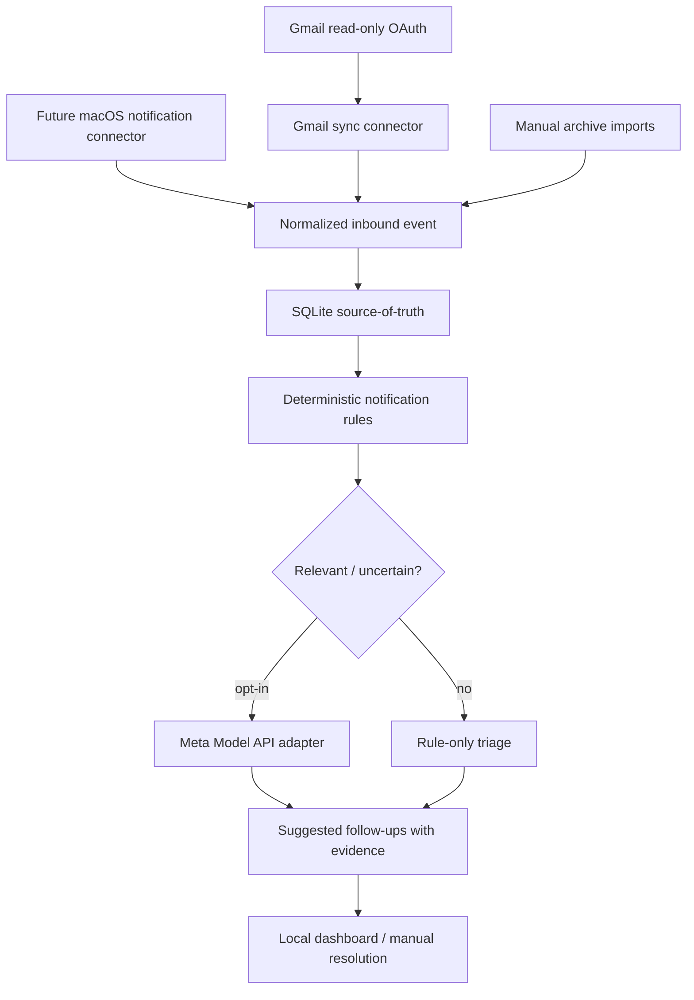

# Architecture — MVP

## Domain objects

- **SourceEvent:** `(source, external_id)` is globally unique; includes provenance, source URL, source timestamp, normalized preview and classification metadata.
- **Identity:** externally observed platform handle/email, attached to a contact only after manual or high-confidence identity resolution.
- **Contact:** one human/org; optional notes and relation to project.
- **FollowUp:** proposed task with `needs_review`, `needs_reply`, `waiting_on_them`, `follow_up`, `resolved`, `ignored` and supporting evidence.
- **SyncCursor:** per connector/account high-water mark committed atomically with events.
- **ModelInference:** later add auditable model version, privacy decision, structured output, evidence and cost/tokens.

## Invariants

- A notification is not a transcript, and receipt does not imply an unanswered message.
- No automated identity merge on names alone.
- All external API errors explicit. Never fake a successful sync.
- All data is exportable and deletable, with a self-hostable persistence layer.
- No agent writes to Gmail or social platforms.

## Gmail design

1. OAuth installed desktop app, `gmail.readonly` scope, token stored in OS protected secret store or local file with strict permissions; don't commit credentials.
2. Initial sync via `users.messages.list` with explicit user query and bounded date range, fetch details selectively. Persist Gmail `historyId` from `users.getProfile` at a deliberate safe point; handle messages arriving during initial backfill with overlap + idempotent replay.
3. Every five minutes, use `users.history.list` from committed `historyId`, following all pages and handling adds/deletes/label changes as relevant.
4. Commit event inserts and cursor advancement atomically (in small recoverable batches).
5. On expired `startHistoryId` (404), perform a bounded recovery sync and prove no silent gap; preserve previous history rather than destructive reset.
6. Handle retries on 429/5xx, refreshing OAuth on 401 when appropriate; stop and request reauth for persistent access issues.
7. Use provider message IDs as dedupe keys; keep extraction rule versions separate from source evidence.

## Future notifications

iPhone Mirroring exposes some app notifications to macOS; it is not guaranteed to deliver complete inbox state. A Mac notification observer must be explicitly permissioned and tested on the target macOS version, and its reliability must be documented before enabling background use.
